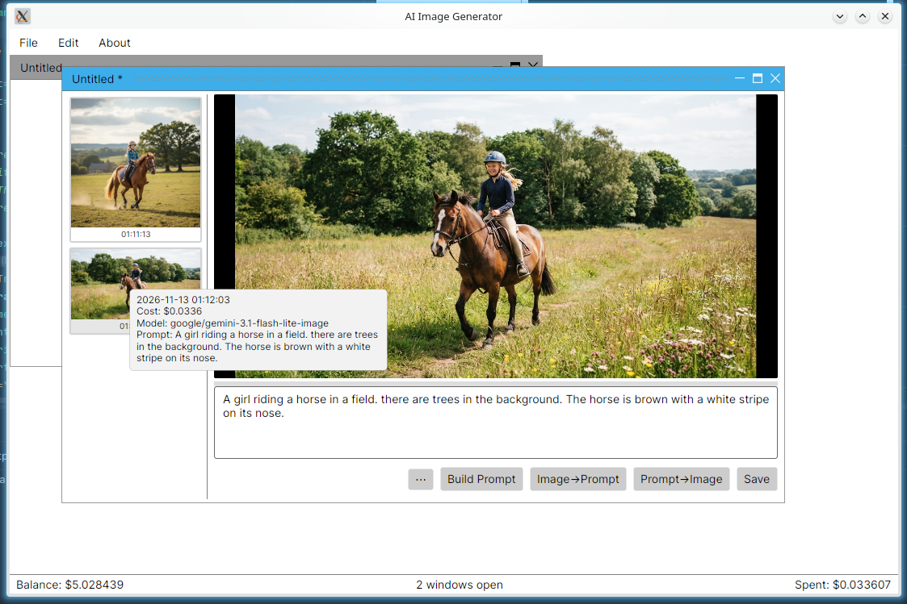
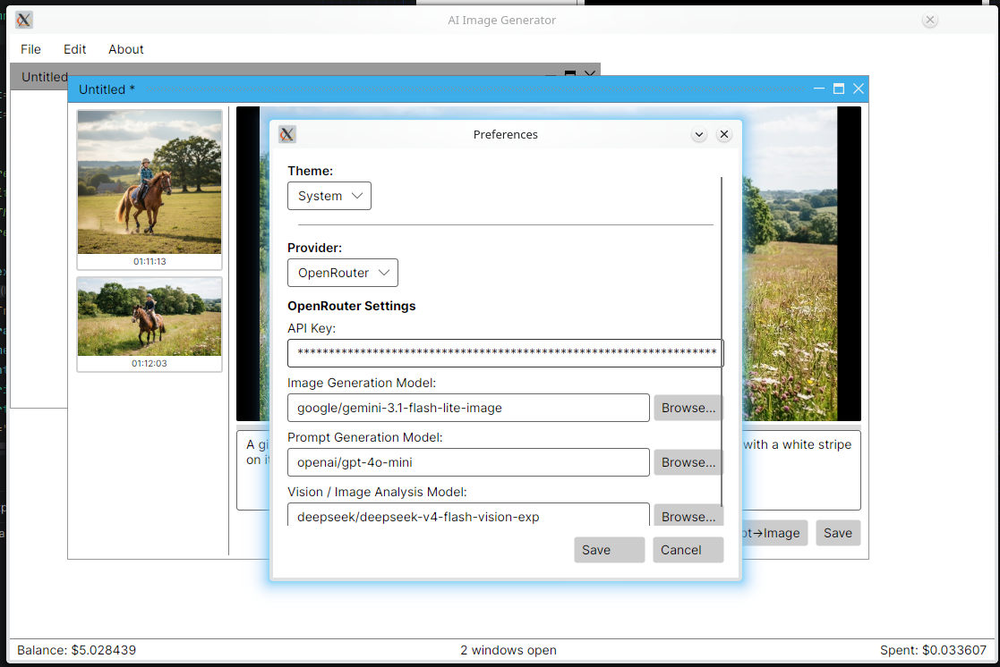
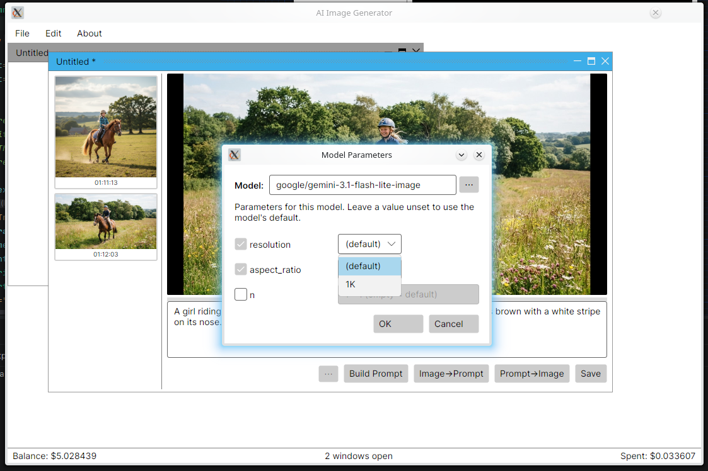
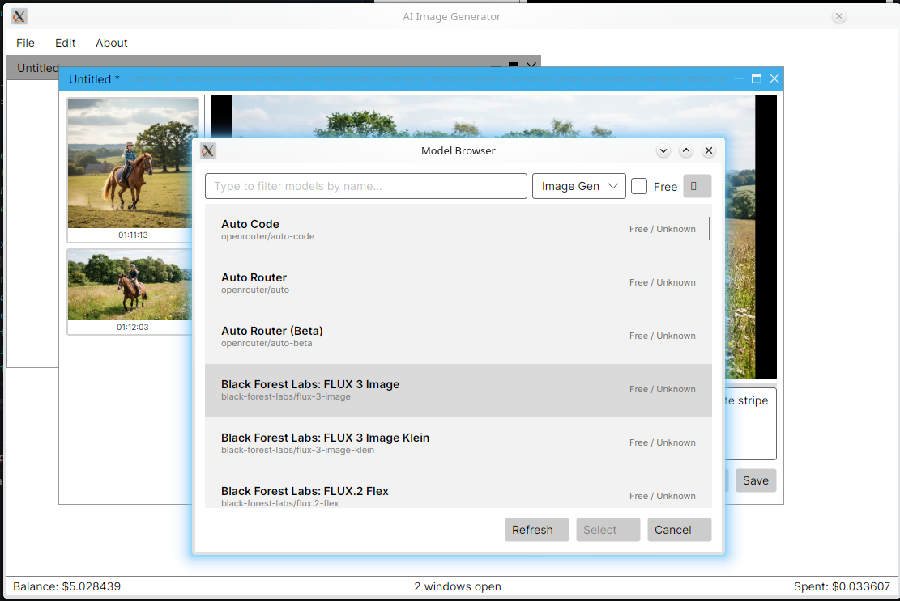
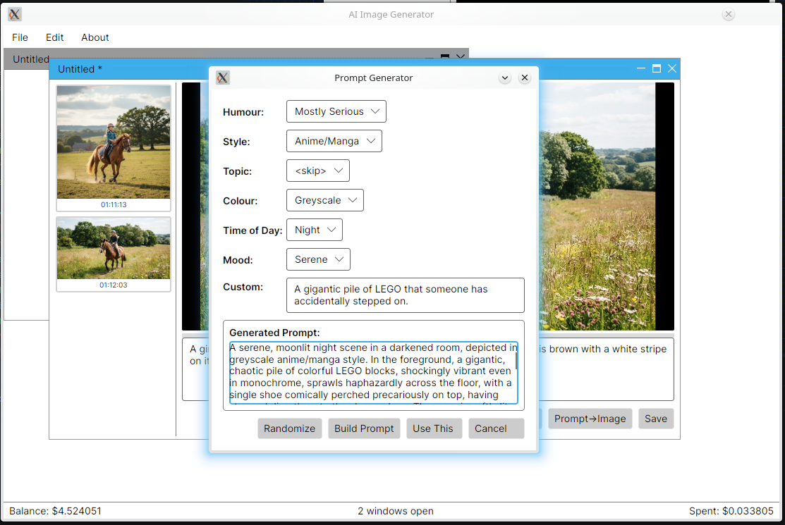

# AI Image Generator — User Manual

Everything the app can do, and how to drive it. Screens are described
left-to-right, top-to-bottom, the way you'd meet them using the program.

---

## Contents

1. [Quick start](#1-quick-start)
2. [Main window tour](#2-main-window-tour)
3. [Setting your API key and models (Preferences)](#3-setting-your-api-key-and-models-preferences)
4. [Image windows: generating images](#4-image-windows-generating-images)
5. [The Model Parameters window (⋯ button)](#5-the-model-parameters-window--button)
6. [The Model Browser](#6-the-model-browser)
7. [The Prompt Generator](#7-the-prompt-generator)
8. [Image → Prompt](#8-image--prompt)
9. [History panel](#9-history-panel)
10. [Saving and loading images](#10-saving-and-loading-images)
11. [The status bar](#11-the-status-bar)
12. [Keyboard shortcuts](#12-keyboard-shortcuts)
13. [Troubleshooting](#13-troubleshooting)

---

## 1. Quick start

1. Build and run the app (see the [README](README.md) for setup).
2. Open **Edit → Preferences** and paste your OpenRouter API key.
3. Still in Preferences, click **Browse...** next to *Image Generation Model*
   and pick any model that catches your eye — pricing is shown for each.
4. Close Preferences, type a prompt into the big text box, and press
   **Prompt->Image**.

Your first image should arrive within a few seconds to a minute depending on
the model. The cost of generating it appears in the status bar at the bottom
and in the history tooltip.

---

## 2. Main window tour

The main window is deliberately minimal: a menu bar, a large MDI work area
where your image windows live, and a status bar.

```
┌────────────────────────────────────────────────────┐
│ File  Edit  About                                   │  ← menu bar
├────────────────────────────────────────────────────┤
│                                                    │
│              (image windows here)                  │  ← MDI area
│                                                    │
├────────────────────────────────────────────────────┤
│ Balance: $12.50        2 windows open     Spent: $0.04 │  ← status bar
└────────────────────────────────────────────────────┘
```

### Menus

| Menu | Item | Shortcut | What it does |
|---|---|---|---|
| **File** | Load | `Ctrl+L` | Open a saved PNG (with its prompt metadata) as a new image window |
| | Quit | `Ctrl+Q` | Exit the app (asks if you have unsaved images) |
| **Edit** | New Image | `Ctrl+N` | Create a fresh, blank image window |
| | Preferences... | `Ctrl+,` | Open the Preferences dialog |
| **About** | About | | Show the about box |


<br>
*Above: an image document window showing the history panel, canvas, prompt textarea and the controls row (⋯, Build Prompt, Image→Prompt, Prompt→Image, Save).*

### Image windows

Each image document is a floating window inside the MDI area. Windows can be:

- **Dragged** by their title bar,
- **Resized** from any edge or corner,
- **Maximized / restored** with the middle title-bar button,
- **Minimized** to a small bar along the bottom with the left button,
- **Closed** with the ✕ button — you'll be asked to confirm if the window
  contains unsaved images.

There's no fixed limit on how many windows you can have open. Each one runs
its own generation, so you can queue up several prompts at once.

---

## 3. Setting your API key and models (Preferences)

**Edit → Preferences** (`Ctrl+,`) is where the app is configured. Changes
take effect when you press **Save**; **Cancel** discards them.

### API key

Paste your key from [openrouter.ai/keys](https://openrouter.ai/keys) into the
**API Key** field. The key is stored on your machine (in your OS user config
folder — *not* in the project directory) and sent only to OpenRouter.

### Choosing models

Three models are configured, each with a **Browse...** button that opens the
[Model Browser](#6-the-model-browser):

| Field | Used for |
|---|---|
| **Image Generation Model** | The default model that generates your images |
| **Prompt Generation Model** | The chat model that powers the Prompt Generator |
| **Vision / Image Analysis Model** | The vision model used for Image → Prompt |

The *Image Generation Model* is the one that matters most — it's the default
for every new image window (individual windows can override it; see the next
section).

When you pick a generation model, the app queries OpenRouter for that model's
supported parameters and stores them, so image windows know what settings the
model accepts. This happens automatically; you never see it.


<br>
*Above: the Preferences window where you configure your API key, choose your models and set the theme.*

### Theme

Choose **Dark**, **Light**, or **System** to match your desktop.

---

## 4. Image windows: generating images

Each image window is split into three areas:

```
┌────────────┬────────────────────────────────────┐
│            │                                    │
│  History   │           Image canvas              │
│  panel     │        (click ⋯ to change          │
│            │         model & settings)          │
│            ├────────────────────────────────────┤
│            │  prompt textarea                   │
│            │  [⋯] [Build Prompt] [Image->Prompt] │
│            │  [Prompt->Image] [Save]             │
└────────────┴────────────────────────────────────┘
```

The vertical bar between the canvas and the prompt area is a **splitter** —
drag it to give more room to the image or the prompt. The prompt box scrolls
when the text gets long.

### Generating an image

1. Type your prompt in the large text box.
2. Press **Prompt->Image** (or just click it with the mouse).
3. The canvas dims and shows a progress bar while the model works.
4. The finished image appears in the canvas and in the history panel on the
   left.

The window title shows a `*` when you have unsaved changes.

---

## 5. The Model Parameters window (⋯ button)

The **⋯** button next to *Build Prompt* opens the Model Parameters window for
**this image window only**. This is where you override the default model and
set model-specific parameters.

### Changing the model

The top row shows the window's current model with an **ellipsis (⋯) browse
button**:

- Click **⋯** to open the Model Browser and pick a different model.
- The app queries OpenRouter for the new model's parameters and **rebuilds
  the whole parameter list** — old settings are removed, the new model's
  settings appear with default values.
- Press **OK** to apply the change to this window, or **Cancel** to forget
  it. The change affects only this window — your Preferences default and
  every other window are untouched.

### Setting parameters

Each parameter the model supports is listed with a **checkbox**:

- **Unchecked** — the parameter is *not sent* to the API; the model uses its
  own default. The control next to it is greyed out.
- **Checked** — you're choosing a value:
  - **Dropdown parameters** (resolution, aspect ratio, quality, output
    format...) show the exact values the model accepts, with *(default)* as
    the first entry.
  - **Numeric parameters** (seed, image count, compression) are text boxes
    with validation — the allowed range is shown as a grey hint inside the
    box, and out-of-range values show a red error until corrected. **OK** is
    blocked while any value is invalid.
- **Mandatory parameters** like *resolution* and *aspect ratio* start
  checked and their checkbox is disabled — they control output size and
  can't be switched off.

> **Tip:** if you set *resolution* or *aspect ratio*, you've told the model
> exactly what output shape you want. If you leave them at *(default)*, the
> model picks its own default size.

Press **OK** to apply your choices to this window; **Cancel** discards them.
Parameters are remembered per window and saved into the image's metadata
when you save.


<br>
*Above: the Model Parameters window showing the per-window model override and the list of configurable parameters for the selected model.*

---

## 6. The Model Browser

Opened from Preferences (**Browse...**) or from the Model Parameters window
(**⋯**). Shows every model OpenRouter offers, including the full image
catalogue (Seedream, Flux, Gemini, GPT-Image, Qwen, and many more — the
plain model list hides most of these, but this browser shows all of them).

### Toolbar

| Control | Purpose |
|---|---|
| **Search box** | Live-filters by model name or ID as you type |
| **Filter dropdown** | Show *Image Gen* models only, *Vision* models only, or *All Models* |
| **Free checkbox** | Limit the list to free models |
| **⟳ (refresh icon)** | Re-fetch the model list from OpenRouter |

When opened, the browser loads automatically with the filter that matches
what you're picking (Image Gen when choosing a generation model, Vision when
choosing a vision model, and so on).

Each row shows the model's display name, its ID, and its **pricing** (per
image and/or per token) on the right. Click a model to select it, then
**Select** to use it — or **Cancel** to keep what you had.


<br>
*Above: the Model Browser listing available image-generation models with their IDs and pricing.*

---

## 7. The Prompt Generator

Feeling uninspired? **Build Prompt** opens a generator that rolls themed
random prompts and lets an LLM write the prompt *for* you.

### The dropdowns

Six themes, each with dozens of values:

| Theme | Examples |
|---|---|
| **Humour** | Deadly Serious → Total Comedy |
| **Style** | Cartoon, Oil Painting, Pixel Art, Photorealistic, ... |
| **Topic** | Trains, Space, Dragons, Cyberpunk Streets, ... |
| **Colour** | Vivid, Pastel, Neon, Black and White, ... |
| **Time of Day** | Dawn, Midday, Dusk, Midnight, ... |
| **Mood** | Peaceful, Chaotic, Dreamy, Epic, ... |

### Controls

- **`<skip>`** — the first entry in every dropdown. Choose it to leave that
  theme out of the generated prompt entirely (the LLM decides for itself).
- **Randomize** — rolls a random value into every non-skip theme. `<skip>`
  is never rolled randomly; it stays a deliberate choice.
- **Custom** — a free-text box for extra instructions ("...but make it a
  lighthouse", "in the style of a 1950s travel poster").
- **Build Prompt** — sends your combination to the prompt-generation model,
  which writes a detailed image prompt. The result appears in the preview
  area. **Use This** puts it into the window's prompt box.
- **Cancel** — close without changing your prompt.

Both the **Custom** box and the **generated prompt** preview scroll
vertically when their contents overflow.


<br>
*Above: the Prompt Generator dialog with humour, style, topic, colour, time of day and mood dropdowns, plus controls to randomise and build.*

Every Build Prompt call costs a tiny amount (fractions of a cent) which is
added to the session total.

---

## 8. Image → Prompt

Have an image and want to know how to make something like it? With an image
in the window, press **Image->Prompt**:

1. The current image is sent to your **Vision model**, which describes it as
   a detailed image-generation prompt (subject, setting, lighting, colours,
   composition, style, mood).
2. The description replaces the prompt box contents.

From there you can tweak it and generate a new image with any model — a nice
way to chase a look with a different model than the one that made the
original.

---

## 9. History panel

The left column of every image window keeps a thumbnail of every image
generated in that window, newest at the bottom.

- **Click a thumbnail** to restore that image to the canvas — its prompt is
  restored to the prompt box, and the parameters it was generated with are
  restored into the window.
- **Hover a thumbnail** to see exactly how it was made:
  ```
  2026-11-13 14:23:07
  Cost: $0.0400
  Model: bytedance-seed/seedream-5-5
  Prompt: a red panda astronaut floating in space...
  ```
- The blue border marks the currently-displayed image.

The history belongs to the window — closing the window discards its history
(unsaved images are confirmed first).

---

## 10. Saving and loading images

### Saving

With an image displayed, press **Save**:

- Choose a location and filename (a timestamped default is suggested).
- The app writes **two files**:
  - `yourimage.png` — the image itself
  - `yourimage.png.prompt` — a small JSON sidecar recording:
    - the **prompt**,
    - the **model** that generated it,
    - the **parameters** used,
    - the **cost**.

Saving is per image-generation: after saving, the window's `*` (unsaved)
marker clears for that image.

### Loading

**File → Load** (`Ctrl+L`) opens any PNG. If a `.prompt` sidecar sits next to
it, the app restores:

- the **prompt**, and
- the **model that made the image** — the loaded window adopts it as its own
  generation model (fetching that model's parameter schema from the API if
  it isn't the one configured in Preferences), and
- the **saved parameters**, applied onto that model's schema.

So loading an image made with a different model gives you a window ready to
continue in that model — no switching needed. Your Preferences default and
other windows are untouched.

Plain-text `.prompt` files from very old versions of the app still load
(prompt only, no model metadata).

---

## 11. The status bar

The strip along the bottom of the main window:

| Left | Centre | Right |
|---|---|---|
| **Balance: $12.50** | **2 windows open** | **Spent: $0.0410** |

- **Balance** — your remaining OpenRouter credit, refreshed at startup and
  after every billable request. Shows `—` if it can't be fetched (e.g. no API
  key yet).
- **Windows open** — a live count of your image windows.
- **Spent** — the total cost of **this session**: every image generation,
  every Build Prompt, and every Image→Prompt call, summed. It resets to zero
  each time the app starts — so it answers "what did this sitting cost me?"

---

## 12. Keyboard shortcuts

| Shortcut | Action |
|---|---|
| `Ctrl+N` | New image window |
| `Ctrl+L` | Load image |
| `Ctrl+,` | Preferences |
| `Ctrl+Q` | Quit (with unsaved-changes confirmation) |

---

## 13. Troubleshooting

**"OpenRouter API key is required"** — you haven't set a key. Edit →
Preferences → paste your key from openrouter.ai/keys.

**"Model returned text instead of an image" / "no image in response"** — the
selected model doesn't generate images (some models can only chat). Pick an
image model in the browser (filter to *Image Gen*).

**A generation fails with a 400 about size/resolution conflict** — you've
set both a resolution-type parameter and something that contradicts it.
Clear one of them (uncheck it back to default) and retry.

**The parameters list is empty for a model** — that model exposes no
user-settable parameters through the API; everything runs on defaults. The
⋯ window will simply say so.

**Balance shows `—`** — the credits query needs a valid key; check
Preferences. (The query may also be unavailable in some regions.)

**The app didn't remember my model parameters after restart** — the schema
is fetched when you pick a model in Preferences and stored in your local
config. Re-picking the model in Preferences → Browse... refreshes it.

---

*AI Image Generator — a personal tool. Built with Avalonia and OpenRouter.*
