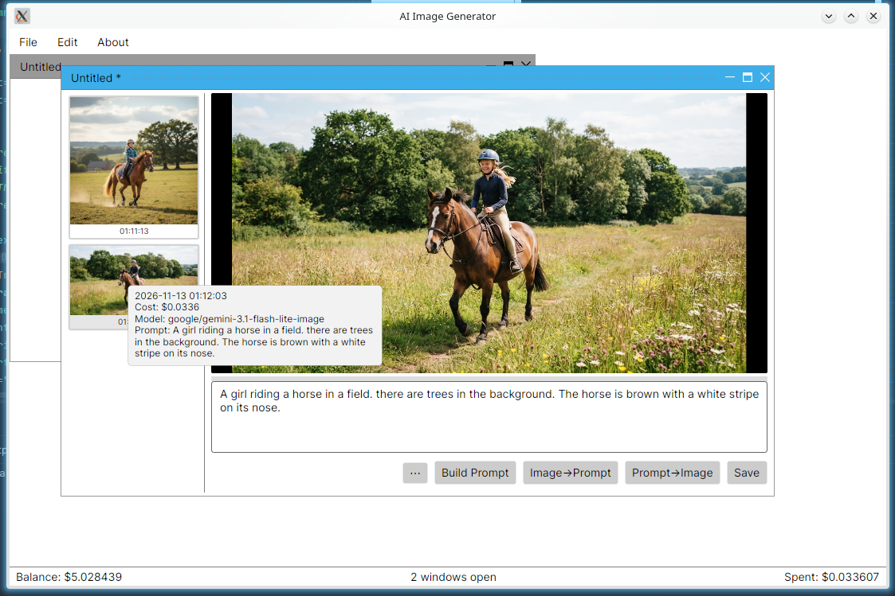

# AI Image Generator

A friendly little desktop app for generating AI images — built because I wanted
image generation to be *easy*: I just wanted to pick a model and set it as the 
default, perhaps twiddle a few settings and hit Generate. No forms full of
JSON settings and unknown parameter, no wrestling with API docs.

**NOTE:** this is a tool I built for myself. It's just made for how *I* like to
work, and it's not aiming to be a product. But if you have an
[OpenRouter](https://openrouter.ai) account, it makes generating AI images
nicely painless — and you're welcome to build it and try it out.

Want to see it in action? Here's the main image document window (set to 800×600):

[](https://github.com/nww02/OpenRouter-Image-Generator/blob/master/Image%20Generator/Screenshots/Screenshot_20261113_011210.png?raw=true)

## What it does

### 🖼️ Generate images from prompts
A multiple-document interface (MDI): every image opens in its own floating
window with its own canvas, prompt box, and generation history. Generate ten
variations of an idea across ten windows if you like — each window works
independently.

### 🤖 Model selection that's actually automatic
The core annoyance this app solves: **choosing a model and setting parameters
is automatic and easy.**

- Browse OpenRouter's full image-model catalogue (60+ models — Seedream, Flux,
  Gemini, GPT-Image, Qwen, and more) with live pricing shown per model.
- When you pick a model, the app **queries the API to discover that model's
  parameters** — resolutions, aspect ratios, quality levels, whatever that
  model supports — and builds the settings panel for you. Enum parameters
  become dropdowns, numeric ranges become validated text boxes. No guessing
  what a model accepts.
- The model you pick in Preferences becomes the default for new windows, but
  **every window can override the model and its parameters individually** via
  the ⋯ button — great for trying a different model on one idea without
  changing your setup.

### 🎲 Random prompt generator
A fun one: a dialog with themed dropdowns — humour, style, topic, colour, time
of day, mood. Hit **Randomize** to roll the dice, then **Build Prompt** to have
an LLM turn the combination into a rich, detailed image prompt. Any topic you
don't care about can be set to `<skip>` and it's left out entirely. It makes
generating randomized images a genuinely fun toy.

### 👁️ Image → prompt
Have an image you love? The app uses vision models to describe it as a fresh
generation prompt — so you can chase a similar look with any model you like.

### 💾 Images remember how they were made
When you save an image, the app writes a companion `.prompt` file alongside
the PNG containing:

- the **prompt** used,
- the **model** that generated it,
- the **parameters** it was generated with,
- and the **cost** of generating it.

Load the image back in later and you can see exactly how it was made — and the
loaded window picks up **that image's model and parameters** automatically, so
you can continue right where it left off, whatever model you're currently
using elsewhere.
Hover any thumbnail in the history panel to see when it was made, what it cost,
and which model made it.

### 💰 Costs at a glance
The status bar keeps track of your session: remaining **account balance** on
the left, **open windows** in the centre, and **total spent this session** on
the right (image generations, prompt building, and image→prompt analysis all
count). The session total resets each time the app loads, so you always know
what this sitting cost you.

## Getting started

1. Install the [.NET 10 SDK](https://dotnet.microsoft.com/download).
2. Build and run:
   ```
   dotnet run --project "Image Generator"
   ```
3. Open **Edit → Preferences**, paste your
   [OpenRouter API key](https://openrouter.ai/keys), and pick your models
   (the Browse buttons show every model with its pricing).
4. Type a prompt, hit **Prompt->Image**, done.

Your API key is stored in your OS user config folder
(`~/.config/ImageGenerator/` on Linux, `%APPDATA%\ImageGenerator\` on Windows)
— never in the repo, and never sent anywhere except OpenRouter.

## Built with

- [Avalonia 12](https://avaloniaui.net/) — cross-platform .NET UI
- [Dock.Avalonia](https://github.com/wieslawsoltes/Dock) — the MDI window
  system
- [OpenRouter](https://openrouter.ai/) — one API, dozens of image models
- [CommunityToolkit.Mvvm](https://github.com/CommunityToolkit/dotnet) — MVVM
  plumbing

## A note on scope

This app talks to OpenRouter only — that's the whole point. One account, one
key, every model. Local-model support and other providers were
deliberately left out to keep it simple. I might add that later, if I ever
get the money to buy a PC with a proper gfx card to run my own models.

Enjoy 🎨
